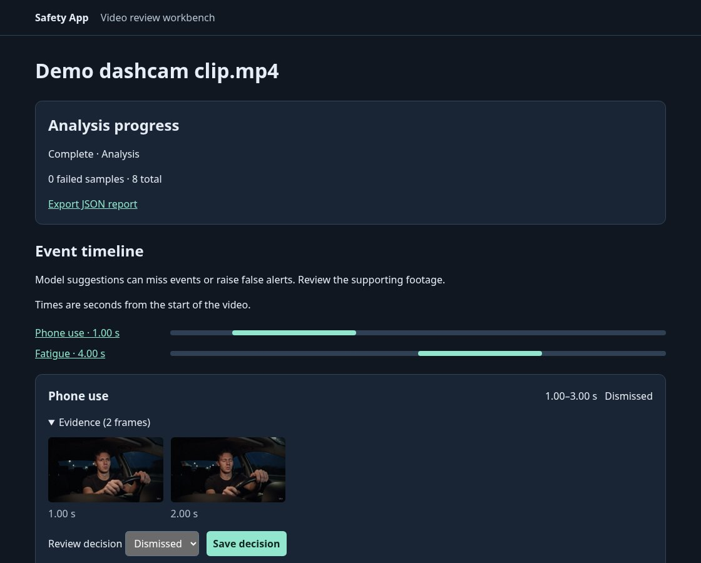

# Safety App video-event review workbench

## Demo

The event timeline shows two scripted detections from the repository’s sample dashcam clip. The reviewer expanded the supporting frames and dismissed the phone-use alert. The reviewed report is available through **Export JSON report**.



## Run locally

Run on a trusted local machine with Python 3.10+, FFmpeg, FFprobe and Ollama.

```sh
python -m venv .venv
. .venv/bin/activate
pip install -r requirements.txt
ollama pull llama3.2-vision:11b
python workbench.py
```

In another shell with the same environment and working directory, run `python app.py` and open http://127.0.0.1:5000. Set `SAFETY_JOBS` in both shells to use a different persistent local directory. Set `SAFETY_MODEL` consistently if using a different Ollama model.

Open two tabs and queue both clips. Each redirect opens a different job with its own progress. Cancel one job, then inspect the other job's event evidence, mark an alert dismissed and export its JSON report. The report captures the model observations, event evidence references, and reviewer decisions. Still images retain frame observations without video intervals.

The worker has two local slots. It resumes queued or interrupted work after restart. Retry reuses successful frame observations and retries incomplete extraction or failed/pending frames. Exact evidence matches retain their review on retry. Events with changed evidence require a fresh decision. Media cancellation is polled during FFmpeg and FFprobe. During inference it takes effect after the current Ollama call returns or times out.

Uploads are capped at 100 MiB, video duration at 120 seconds, source FPS at 120, and sampling at 1–4 FPS with at most 240 samples. Accepted files are decoded using a restricted input format. Frame times refer to the zero-based sampling grid. Event end is exclusive and bounded by clip duration. The initial rule requires two consecutive positive samples. A known negative breaks a run. The rule is provisional pending evaluation on independently labeled footage.

The app uses private job URLs as bearer links and keeps recent links in local browser storage. Keep the service on loopback and treat job URLs and exports as sensitive. Job data is retained for review and retry. To remove retained media, stop both processes and remove the specific job directory under `SAFETY_JOBS`. Temporary extraction files belong only to their job.

## Event evaluation

Export reports for separate development and held-out clips covering normal conditions, darkness, blur and occlusion. Use staged or licensed footage with recording and evaluation rights. Have reviewers label all category intervals independently of model output and include clips with zero events. Keep recordings from the same original drive or source together, and record that grouping as `source`. Every manifest is a JSON array, for example:

```json
[
  {
    "report": "exports/normal-01.json",
    "source": "staged-drive-01 (recording permission on file)",
    "condition": "normal",
    "labels": [{"category": "phone_use", "start": 2.0, "end": 5.0}]
  }
]
```

```sh
python evaluate.py held-out.json --tune development.json
```

Development F1 selects the temporal rule from two or three positive samples and one or two sample steps between positives. The held-out run reports one-to-one category and temporal IoU matching (default 0.5), precision, recall, false alerts per video hour and video seconds processed per worker second, overall and by condition. Use a consistent sampling rate and model when comparing thresholds. Ratios with zero denominators are null. Partial reports are included and failed samples are counted. A fully failed job requires investigation before scoring and must be reported alongside benchmark coverage. Speed excludes queue waiting and includes completed processing attempts. Model observations are Boolean and do not express calibrated probabilities.

Run `python -m unittest discover -s tests` for the local workflow regression suite. It uses generated videos and scripted detections to verify the software path. Representative model quality requires the independently labeled clips and a running Ollama model.
